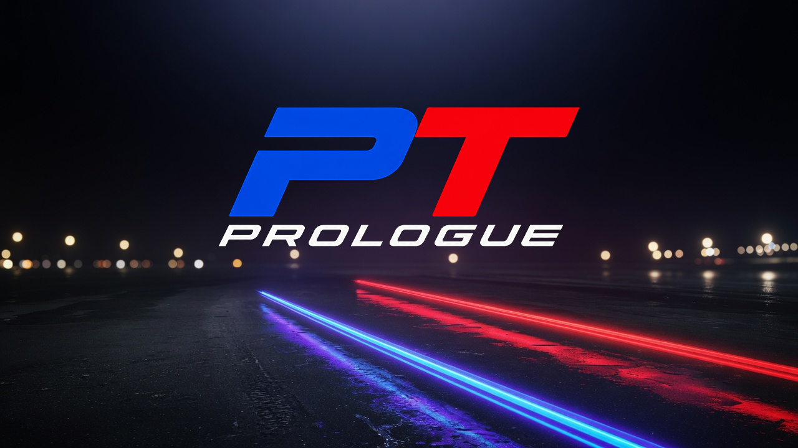

<p align="center">
  
</p>

# Tourline Prologue

**Gran Turismo 5 Prologue: unofficial PC port (static recompilation)**

[](https://github.com/mathewdouglas/Tourline-Prologue/actions/workflows/no-game-files.yml)
[](LICENSE)

[](https://github.com/mathewdouglas/Tourline-Prologue/releases)
[](https://github.com/mathewdouglas/Tourline-Prologue/releases)


**[Release notes](docs/release-v0.2.1.md)** · **[Getting started](#getting-started)** · **[Known problems](#known-problems)** · **[Player setup](docs/player-setup.md)** · **[Shader preparation](docs/shader-precompile.md)** · **[Progress](docs/progress.md)** · **[Roadmap](ROADMAP.md)** · **[Changelog](CHANGELOG.md)** · **[AI use](docs/AI.md)**

An unofficial port of **Gran Turismo 5 Prologue** (PS3, US disc BCUS98158) to Windows x64. It is a static recompilation: the game's own code, translated ahead of time to native x64, then run with a Direct3D 12 renderer. No emulator runs while you play. The player build is **Tourline Prologue**. The window title is Project Tourline Prologue.

> **Status: early, partly playable.** The supported disc build boots to the menu, the dealerships draw, and a race loads and drives. The current download is [v0.2.1](https://github.com/mathewdouglas/Tourline-Prologue/releases/tag/v0.2.1). The investigation, with dates and measurements, is in [docs/progress.md](docs/progress.md).

This tree is a fork of [sp00nznet/GT5P](https://github.com/sp00nznet/GT5P), built with [ps3recomp](https://github.com/sp00nznet/ps3recomp).

### What you need

- **Your own US disc copy** of Gran Turismo 5 Prologue, **BCUS98158 version 03.00**, extracted as a folder or as its `PS3_GAME` directory. An ISO is not accepted.
- **Windows 10 or 11, 64-bit**, and a GPU with Direct3D 12.
- **A decrypted `EMAIN.ELF` from that disc**, or an installed copy of RPCS3 that the launcher can use to decrypt a private copy. RPCS3, firmware and keys are not included, and the original dump is left unchanged.

This project ships none of the game. Player notes in the download: [launcher/START-HERE.txt](launcher/START-HERE.txt).

## Getting started

1. Download the Windows ZIP from [v0.2.1](https://github.com/mathewdouglas/Tourline-Prologue/releases/tag/v0.2.1) on the [releases page](https://github.com/mathewdouglas/Tourline-Prologue/releases).
2. Extract the entire ZIP to a normal folder. Do not run it from inside the ZIP.
3. Run **tourline-prologue.exe**. Choose where to keep saves, settings and shaders (the default folder, or an empty folder on another drive). Then select your extracted disc folder.
4. If `EMAIN.ELF` is not already available, choose your installed RPCS3 when asked, or choose a decrypted `EMAIN.ELF` made from your own `EMAIN.SELF`.
5. Use **tourline-prologue.exe** for every later launch. Setup is remembered. Press **F1** for settings. The first preset is 720p with 2x MSAA.

The file `runtime/gt5p.exe` is the engine. It is not the icon you double-click.

Optional shader preparation, after setup and with the game closed: run **Prepare shaders.cmd**. It reads the game folder you already selected. No separate asset copy, Python install or compiler install is required. It can take several minutes and uses extra disk space. Cancelling keeps finished work; run the same command again to resume. Later launches use a preparation only after it verifies. `tourline-prologue.exe --no-prepared` returns to the ordinary cache and does not delete either cache.

To move saves and shaders, close the game and run **Change storage.cmd**. To point at a different dump, run `tourline-prologue.exe --setup`. For an update, close the game and extract the new ZIP into its own folder. Your selected storage stays where it is.

More detail: [launcher/START-HERE.txt](launcher/START-HERE.txt), [docs/player-setup.md](docs/player-setup.md), [docs/release-v0.2.1.md](docs/release-v0.2.1.md). Changes per version: [CHANGELOG.md](CHANGELOG.md).

## Known problems

- Shader preparation is optional and partial. The v0.2.1 starter covers observed menu, High Speed Ring, Daytona and Fuji Speedway F pipelines at the supported settings. Other cars, cameras, track sections and settings still compile on demand. A consistent reduction in stutter has not been established.
- A locked 60 frames per second is not guaranteed. The first visit to a new effect can pause the picture while shaders compile.
- Post-race replay has been reported with several overlaid copies of the scene, and replay controls have been reported missing. Those reports are still open.
- The keyboard is used when no controller is connected. Some assignment-page text still names PlayStation buttons.
- Only the US disc build BCUS98158 v03.00 is supported.

The measurement record is [docs/progress.md](docs/progress.md). For a bug report, enable **F1 → DEBUG → Debug export** before the fault, then use **F3 → Export debug report** (or **F8** while F3 is open) and attach the ZIP from `logs/debug/`.

## Building from source

The supported way to play is the release ZIP above. A source build targets the same disc executable, BCUS98158 v03.00. You need your own dump, Windows 10/11 x64, Visual Studio 2022 (C++ workload), LLVM 18+ (`clang-cl`), CMake 3.20+, Ninja and Python 3.10+.

`python scripts/setup_runtime.py` prepares the pinned ps3recomp checkout. Per-build addresses live in [config/targets.json](config/targets.json). The integration notes are [docs/ps3recomp-upgrade.md](docs/ps3recomp-upgrade.md). Packaging the player ZIP is [docs/player-setup.md](docs/player-setup.md).

From a dump of your own disc:

```bash
python scripts/setup_runtime.py
T=../ps3recomp-gt5p-v018/tools
rpcs3 --decrypt <dump>/PS3_GAME/USRDIR/EMAIN.SELF     # writes EMAIN.elf beside it
cp <dump>/PS3_GAME/USRDIR/EMAIN.elf input/EMAIN.ELF
mkdir -p input/pkg && cp -r <dump>/PS3_GAME/PARAM.SFO <dump>/PS3_GAME/USRDIR input/pkg/
echo BCUS98158 > input/target

python scripts/jumptables.py --write
python $T/find_functions.py input/EMAIN.ELF --json --seed-json config/extra_seeds_bcus98158.json --output analysis/functions.json
python -c "import json; f=json.load(open('analysis/functions.json')); json.dump([x for x in f if int(x['start'],16) < 0xE3EC24], open('analysis/functions_code.json','w'))"
PYTHONPATH=$T python scripts/gen_hle_stubs.py input/EMAIN.ELF analysis/hle_stubs.json
python $T/ppu_lifter.py input/EMAIN.ELF --functions analysis/functions_code.json --output generated --code-end 0xE3EC24 --header-name ppu_recomp.h --source-name ppu_recomp.c --hle-stubs analysis/hle_stubs.json
python scripts/setjmp_patch.py
python scripts/spin_patch.py
python scripts/ui_mask_patch.py
python $T/gen_hle_nids.py --all --out src/gen/ppu_hle_nids.cpp
scripts/build.cmd -DGT5P_TARGET=BCUS98158
```

Generated sources stay in gitignored `generated/`. The committed SPU registry is `src/gen/spu_workloads_bcus98158.c`. Captured SPU images are produced locally with `SPU_DUMP_MISS` and `python scripts/lift_spu_jobs.py`. Optional runtime pieces: `scripts\get_sdl2.ps1` and `scripts\get_ffmpeg.ps1`. Then run `play.cmd`.

| Region | ID | Format |
|--------|----|--------|
| NA (Digital) | NPUA80075 | PSN |
| NA (Disc) | BCUS98158 | Blu-ray |
| EU (Disc) | BCES00071 | Blu-ray |
| JP (Disc) | BCJS30017 | Blu-ray |

This port's player releases target the **US disc build, BCUS98158 v03.00**.

## AI, licence, disclaimer

Tourline Prologue is developed with AI coding agents. The maintainer reviews their work before merging it, and reviews a release before it is published. [docs/AI.md](docs/AI.md).

The port's own code, tools and documentation are [MIT](LICENSE). The licence covers nothing of the game itself. **Gran Turismo** is a trademark of Sony Interactive Entertainment. This is a fan project. It is not affiliated with, endorsed by, or connected to Sony Interactive Entertainment or Polyphony Digital.

**You need your own copy of the game.** This repository contains the port: source, tools and documentation. It contains no game code, data, assets, keys or firmware. `scripts/check_no_game_files.py` refuses those files on every push. Downloads come only from this repository's [GitHub Releases](https://github.com/mathewdouglas/Tourline-Prologue/releases).

Gran Turismo 5 Prologue is © Sony Interactive Entertainment.
